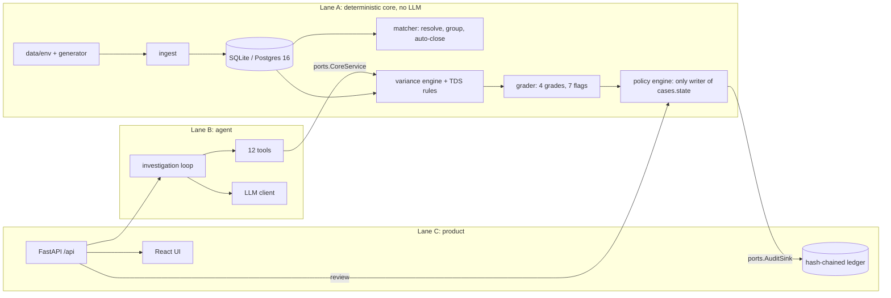

# Artemis

Synthetic Indian AR reconciliation: a deterministic core, an investigating agent, and a reviewer product, built as three lanes that meet at fixed contracts (see the build spec).

All three lanes are in this tree: Lane A (data and deterministic core), Lane B (agent and investigation) and Lane C (API, tamper-evident audit ledger, reviewer UI). Lane B can still run alone: until a real backend is wired, fixture-backed fakes in `artemis/fakes/` stand in.

## Run it

```bash
uv sync
uv run pytest            # offline, no API key (or: make test)
uv run --env-file .env python -m eval.run --runs 3   # live benchmark, writes eval/report.{json,md}
PYTHONPATH=. uv run python -m eval.run --runs 3 --scripted   # same pipeline, no key (golden agent, not an LLM score)
PYTHONPATH=. uv run python -m artemis.agent.batch --scripted --save runs/batch.json
PYTHONPATH=. uv run python -m artemis.agent.batch --replay runs/batch.json   # zero LLM calls
```

LLM: any OpenAI-compatible endpoint, Groq by default. Copy `.env.example` to `.env` and set `LLM_API_KEY` and `LLM_MODEL` (pick a current tool-calling model; the name is config, never code). `uv run --env-file .env pytest -m live -s` runs the golden hero-case acceptance test against it (`.env` is not auto-loaded; `--env-file` does it).

## Architecture



## How the lanes meet

| Lane | Implements (in `artemis/ports.py`) | Wired in |
|---|---|---|
| A | `CoreService`, `PolicyEngine` | `artemis/wiring.py:build_deps("real")` (`SqlCore`, `SqlPolicy`) |
| C | `AuditSink` (`append(case_id, event_type, actor, payload)`) | `SqlAudit`, the hash-chained ledger in `artemis/audit/` |

B's code does not change between backends. The tests in `tests/` run against whichever backend `build_deps` returns.

## For UI work (Lane C)

Everything the UI reads from B is a versioned view-model in `artemis/views.py` (`TraceView`, `BatchStatus`, `MetricsReport`) or `CaseOutcome` in `artemis/models.py`: raw paise, enums and ids only, never formatted strings. JSON Schemas are committed in `contracts/` (`uv run python -m scripts.export_schemas` regenerates; a test fails on drift). Generate TypeScript types from those and restyle freely; nothing in the agent depends on how it is displayed.

## Notes for Lane A (found while building B)

- `PolicyEngine.transition` must allow `INVESTIGATING -> NEEDS_REVIEW` (agent error path) and `NEEDS_REVIEW -> INVESTIGATING` (fresh investigation).
- `request_evidence` only logs the request; the agent loop moves the case to `AWAITING_EVIDENCE` after grading, so a request followed by an Insufficient grade cannot strand a case.
- `CoreService.grade` takes the last `AllocationResult` and the case's `Evidence` rows (with tiers) and returns the grade and contradiction flags.

## Lane C (API, audit ledger, reviewer UI)

```bash
uv run python -m scripts.serve                   # API on :8000, plus the built UI if web/dist exists
cd web && npm ci && npm run dev                  # UI dev server (npm run build writes web/dist, which the API then serves)
cd web && npm test                               # UI tests (vitest)
uv run python -m scripts.export_openapi          # regenerate contracts/openapi.json (a test fails on drift; `npm run gen:api` makes the TS types)
uv run python -m scripts.tamper [seq]            # edit one audit event as the DB owner, then Verify chain goes red
```

- **API** (`artemis/api/`, all under `/api`): `health`, `modes`, `batch/run` + `batch/{id}`, `cases`, `cases/{id}` (+ `/trace`, `/graph`, `/review`), `audit` (+ `/verify`, `/checkpoint`), `metrics`, `reviewers`, `reset`, `demo/tamper` (demo-only, like `reset`: edits one recent audit event as the database owner so the chain visibly breaks). Batch modes are `demo` (the rule-based oracle agent, no LLM), `replay` (a recorded run) and `live` (needs `LLM_API_KEY` and `LLM_MODEL`). Run state lives in the process, so run a single worker.
- **Ledger** (`artemis/audit/`): every audit event is hashed over the previous one (`prev_hash`), `audit_events` and `audit_checkpoints` are append-only (a trigger raises on UPDATE or DELETE, SQLite and Postgres variants), and checkpoints are Ed25519-signed so a chain can be verified offline. The key is `data/signing_key.pem` (`SIGNING_KEY_PATH` to override; git-ignored).
- **Settings:** `DATABASE_URL` (the server defaults to `sqlite:///data/artemis.db`; `artemis.api.main` alone uses in-memory SQLite), `ARTEMIS_API_TOKEN` (when set, write routes need `Authorization: Bearer <token>`), `DEMO_MODE` (default `1`; `0` disables `POST /reset`), `FORCE_HTTPS`, `REPLAY_FILE`, `RUNS_DIR`, `EXPORTS_DIR`.
- **UI** (`web/`): built for people who have never seen receivables reconciliation. The dashboard opens with a plain-language explainer and a worked example (the hero case's ₹26,000 TDS gap), glossary tooltips (TDS, UTR, variance…) and a **Guided demo** that walks the spec's five-minute script and drives the app (it can click Run batch for you). **Agent paths** puts the hero case and its two twins side by side: what the tax-credit extract returned, the tool sequence each run took (steps that only some runs make are highlighted), and why each was graded as it was. Case pages explain the grade in a sentence and show the variance closure, evidence graph, reviewer panel and agent trace. The **Audit ledger** page verifies the chain and has a tamper demo: simulate an insider edit, watch Verify chain fail at exactly that event (highlighted), then reset. The UI reads raw paise, enums and ids from the API and formats them itself.

## Deploy and demo

```bash
make demo        # docker compose: postgres 16 + api + web (nginx). Migrates, seeds, serves on http://localhost:8080
make demo-down   # stop and delete the volumes
make demo-local  # no Docker: build the UI, seed SQLite, serve everything on http://localhost:8000 (set DATABASE_URL for Postgres)
make seed        # just the migrate + seed step (DATABASE_URL, SIGNING_KEY_PATH)
make smoke       # build the UI and run the Playwright smoke test (BASE_URL, default http://localhost:8000)
make workflow    # the full Playwright walkthrough: 28 checks incl. the answer key's 10/16/6/4/4, blocked approvals, tamper, restart-proofing and a phone-sized screen (needs a freshly seeded server)
```

`deploy/docker-compose.yml` starts the three services. The api container runs `scripts/seed.py` (Alembic to head, create the Ed25519 signing key if it is missing, load `data/env` and run the matcher if the database is empty) and then one uvicorn worker with `ARTEMIS_PREPARE=0`, so a restart keeps the database and the ledger. `.env.example` lists every variable. The images build and the stack runs: the smoke test passes through nginx on :8080, data and the ledger survive an api restart, and `docker exec <api> python -m scripts.tamper 5` turns Verify chain red at event 5. The smoke test (`web/e2e/smoke.mjs`) resets the environment, runs the batch, opens the hero case, approves it as the analyst and verifies the chain; it needs a server in demo mode without `ARTEMIS_API_TOKEN`.

### Hosted copy (Vercel UI + Render API)

The API keeps batch state in the process and runs batches on a background thread, so it needs a long-lived server (Vercel's serverless functions would kill it). The UI is static, so it goes on Vercel and proxies `/api` to the API, which keeps it same-origin and the CSP intact.

- **API:** a Render web service built from `deploy/Dockerfile.api` (it binds `$PORT`), plus a Render Postgres 16. Set `DATABASE_URL` on the service to the database's *internal* URL (`postgres://` is accepted and normalised to the psycopg driver). Without it the service falls back to SQLite inside the container, which works but is wiped on every deploy. `DEMO_MODE=1` leaves `POST /reset` open so a judge can re-run the demo; set `ARTEMIS_API_TOKEN` to lock writes (the UI has no token field, so that disables its buttons).
- **UI:** a Vercel project with root directory `web/`. `web/vercel.json` holds the build settings, the `/api` rewrite to the Render URL (edit it if the API's URL changes), SPA routing and the security headers.
- **Keep UI-only pushes from restarting the API.** Render deploys the whole branch, and a restart drops a batch that is running. In Render, `artemis-api` → Settings → Build & Deploy → Build Filters, add `web/**` and `*.md` under Ignored Paths. If a restart does cut a batch off, the UI says so, the server moves any case it was working on to Needs review (audited), and Run batch carries on with the cases still waiting.
- Free tiers: the Render web service sleeps when idle (first request takes about a minute), its disk is ephemeral (the signing key is regenerated on redeploy), and the free Postgres expires after 30 days.

## Database and migrations

SQLite is the default (in-memory for tests, a file for the server). Postgres 16 is supported through psycopg 3: set `DATABASE_URL=postgresql+psycopg://user@host:5432/artemis`. The suite and the 40-case scripted pipeline pass on both.

```bash
uv run alembic upgrade head                       # DATABASE_URL, else sqlite:///data/artemis.db
uv run alembic revision --autogenerate -m "..."   # after changing a model; a test fails when the models and migrations disagree
```

`0001` creates every table, including the ledger's, and installs the append-only triggers. `Db.reset()` (what `POST /reset` and the tests use) still drops and recreates tables; it is for the demo and tests, not for a database that holds data to keep. With `ARTEMIS_PREPARE=0` the API does not call it on start.

## Lane A (data and deterministic core)

`artemis/` modules, none of which call an LLM: `db.py` (SQLAlchemy 2; SQLite now, Postgres 16 later), `ingest/` (CSV/XLSX/EML into one transaction, loud validation), `matching/` (name normalization and entity resolution, matcher and case builder), `rules/` (versioned TDS table in `tds_rules.yaml`), `grading/` (variance engine, grader, policy engine), `core.py` (`SqlCore`, the `CoreService` implementation).

```bash
uv run python -m data.generator.generate      # rebuild data/env/ + data/cases_truth.json (byte-identical every time)
uv run pytest                                 # every Lane B test also runs on this core (parametrized "real" backend)
uv run python -m eval.run --backend real --scripted --runs 3     # all 40 cases, no API key
ARTEMIS_BACKEND=real uv run --env-file .env python -m scripts.debug_case CASE-0033   # one live case on the real core
```

`build_deps("real")` reloads `data/env`, runs the matcher (10 exact matches auto-close, 30 cases wait as NEW) and returns the Lane A stack on an in-memory SQLite database; set `DATABASE_URL` for a file or Postgres. The Lane B suite, the oracle agent and the evaluation harness run unchanged on either backend.

### Decisions worth knowing
- **Approval limits** apply to what an approval *books as adjustments* (the 26,000 TDS on the hero case), not to the cash received: the spec has the analyst approve the 15,08,000 hero case under a 10,00,000 limit, which only works that way.
- **Aliases are learned.** Every resolved payer writes a `customer_aliases` row and later receipts match against it. The two medium-confidence customers are therefore kept out of the random pools in the generator.
- **Email-only credit notes** become `credit_notes` rows (`email_only` / `agreed_not_issued`, supporting evidence) when Lane B's `parse_remittance` output is saved, so the variance engine can validate them and the grade tops out at PROBABLE.
- **The grader looks for contradictions the agent did not fetch** (a tax-credit row for the same deductor on the payment date, a narration citing another customer's invoice), and a proposed allocation onto an already-applied invoice is a duplicate, never VERIFIED.
- **Flags 1-7** are all implemented. Flag 6 reads the `invoice_amounts` that `parse_remittance` extracts, and flag 7 checks claimed UTRs only.
- **TDS labels and thresholds are config.** `threshold_paise` is `null` (not applied) until checked against the Income Tax Department's published guidance; the UI should say "configured, not advised".

### Hand-offs to Lane C
`SqlPolicy.decide(case_id, reviewer_id, decision)` validates a reviewer's action (Probable and Conflicting cases cannot be approved, limits, duplicate refunds need a controller) and makes the transition; it returns the refusal reason for the UI. Applying allocations to invoices on approve (same transaction) is the API's job. `SqlCore.reset()` is what `POST /reset` calls. The audit sink is the hash-chained `SqlAudit` ledger (Lane C); the in-memory `ListAudit` remains for Lane B's fixtures backend.

### Merging cases
If the agent links a receipt that sits in another case (`propose_allocation` with a UTR from elsewhere), the receipt moves to the proposing case and a case left with no receipts becomes `MERGED` with `merged_into` pointing at the absorber (through the policy engine, so it is audited). Only a case that is still `NEW` can be absorbed; a receipt in an investigated, applied or closed case is refused with a `conflict` error. A merged case still queued in a running batch fails its start-up transition and stays `MERGED`; the batch counts it as one error.

### Not done yet
- Dispute flags: no dispute data exists in the environment, and adding some changes the generator's answer key. The hook is `matcher.DISPUTED`.
- The matcher's own entity resolutions write `customer_aliases` rows but no evidence row (the spec's derived item with the score): evidence belongs to Lane B's `RunStore`, so today the derived row appears when the agent calls `resolve_customer`.
- Lane B's records (runs, tool calls, hypotheses, evidence, batches) are kept in memory and saved as one JSON document in the `run_snapshots` table after each batch, so traces and metrics survive a restart. They are not the spec's separate `agent_runs`/`tool_calls`/`hypotheses`/`evidence` tables.
- Not done here: the hosted copy, the backup video, and the analyst-effort stopwatch figures.
